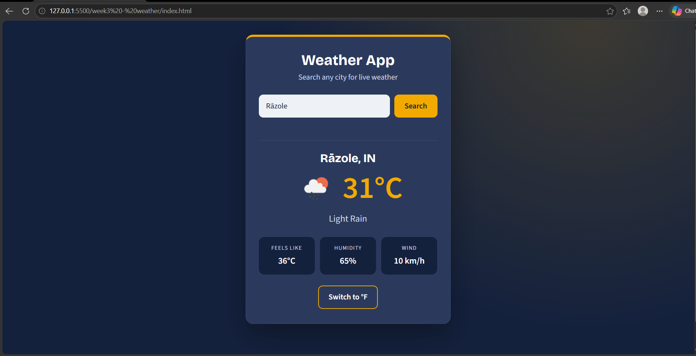

# Weather App

Week 3 assignment (JavaScript Logic and APIs) of the Skill Nexis Web Development Internship.

**Live demo:** https://sony539.github.io/week3-weather/

## Features

- Search any city by name
- Shows current temperature, "feels like", humidity, wind speed and weather condition with an icon
- Switch between Celsius and Fahrenheit
- Clear messages for loading, city not found, invalid API key and network errors
- Remembers the last searched city
- Clean, responsive card UI

## Concepts practised

- Fetch API with `async` / `await`
- Parsing JSON responses
- Handling HTTP status codes and errors with `try` / `catch`
- DOM manipulation and event handling
- Safe rendering with `textContent`

## Tech stack

HTML5, CSS3, JavaScript (ES6), [OpenWeatherMap Current Weather API](https://openweathermap.org/current)

## Project structure

```
week3-weather/
├── index.html
├── style.css
├── script.js
├── config.js
├── README.md
└── screenshot.png
```

## Run it locally

1. Get a free API key from [OpenWeatherMap](https://home.openweathermap.org/api_keys).
2. Open `config.js` and replace `PASTE_YOUR_API_KEY_HERE` with your key.
3. Open `index.html` in a browser (or use VS Code Live Server).

## Screenshot



## Author

Sony Geddam
- GitHub: [sony539](https://github.com/sony539)
- LinkedIn: [sony-geddam-b898723a3](https://www.linkedin.com/in/sony-geddam-b898723a3)
